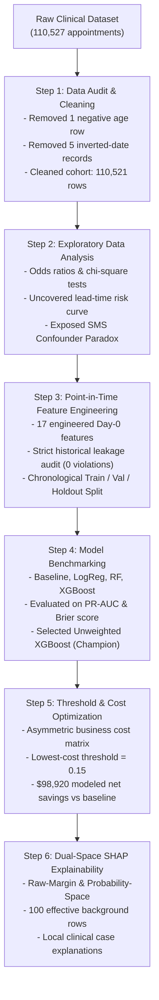
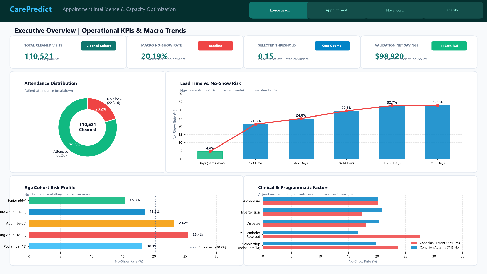
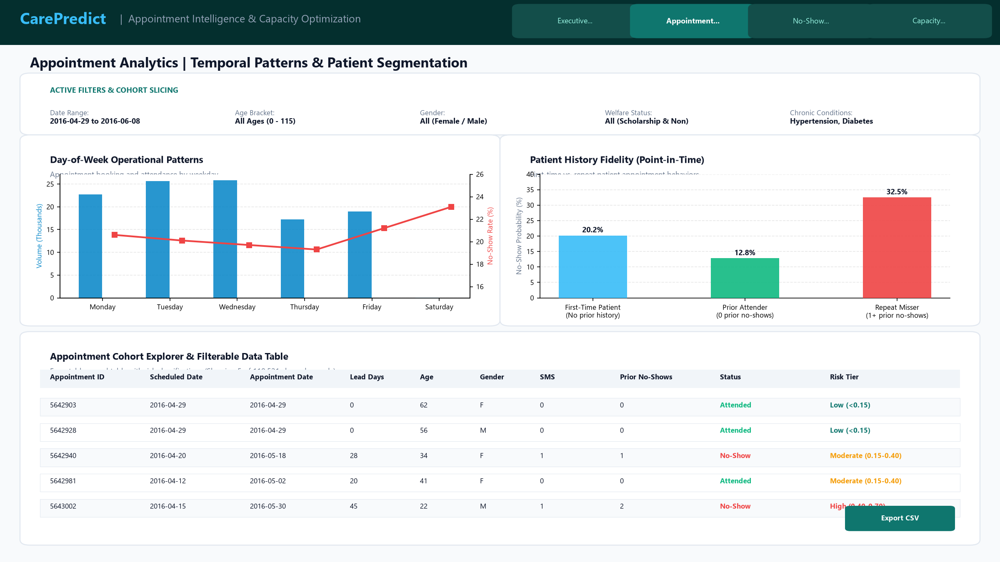
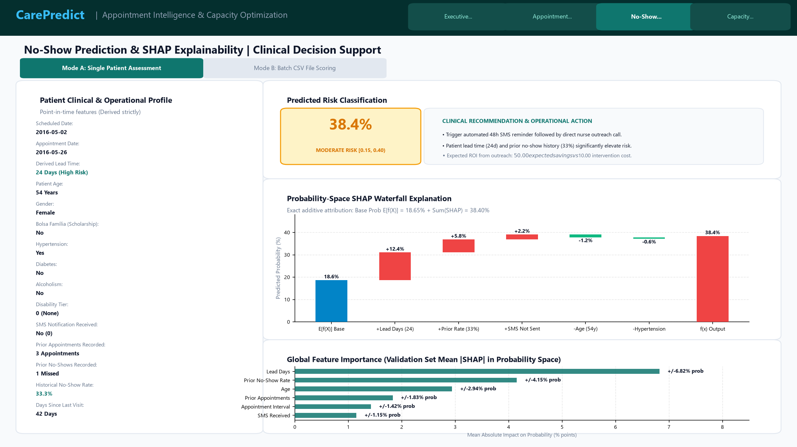
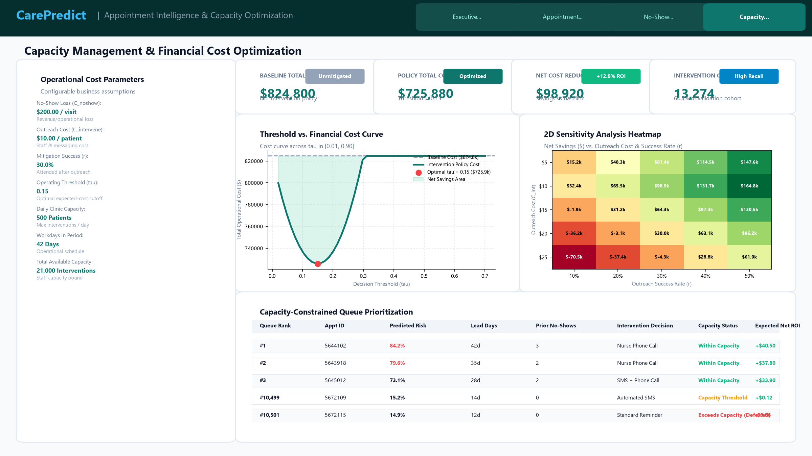

# Healthcare Appointment No-Show Prediction & Capacity Optimization

[](https://www.python.org/downloads/)
[](https://opensource.org/licenses/MIT)
[](https://xgboost.readthedocs.io/)
[](https://shap.readthedocs.io/)
[](https://streamlit.io/)
[](https://plotly.com/)
[]()

> **An end-to-end, reproducible machine learning prototype designed to predict outpatient appointment no-shows at booking time (Day 0), evaluate clinical intervention thresholds under asymmetric costs, and provide cooperative game-theoretic SHAP explanations in probability space for healthcare stakeholders.**

---

## 📑 Table of Contents
1. [Project Title and Overview](#1-project-title-and-overview)
2. [Business Problem and Motivation](#2-business-problem-and-motivation)
3. [Project Objectives](#3-project-objectives)
4. [Dataset Description, Source and Limitations](#4-dataset-description-source-and-limitations)
5. [Complete Project Workflow](#5-complete-project-workflow)
6. [Data Cleaning and Exploratory Analysis](#6-data-cleaning-and-exploratory-analysis)
7. [Feature Engineering](#7-feature-engineering)
8. [Data Leakage Prevention and Point-in-Time Architecture](#8-data-leakage-prevention-and-point-in-time-architecture)
9. [Chronological Split Methodology](#9-chronological-split-methodology)
10. [Model Training and Comparison](#10-model-training-and-comparison)
11. [Model Evaluation and Metric Interpretation](#11-model-evaluation-and-metric-interpretation)
12. [Threshold Selection and Illustrative Business Cost Analysis](#12-threshold-selection-and-illustrative-business-cost-analysis)
13. [Dual-Space SHAP Model Explainability](#13-dual-space-shap-model-explainability)
14. [Interactive Decision-Support Dashboard (CarePredict)](#14-interactive-decision-support-dashboard-carepredict)
15. [Key Findings and Business Recommendations](#15-key-findings-and-business-recommendations)
16. [Limitations, Ethical Considerations and Governance](#16-limitations-ethical-considerations-and-governance)
17. [Installation, Reproducibility and Dashboard Launch Guide](#17-installation-reproducibility-and-dashboard-launch-guide)
18. [Repository Structure](#18-repository-structure)

---

## 1. Project Title and Overview

### Executive Summary
Missed outpatient medical appointments ("no-shows") impose severe financial, operational, and clinical penalties on healthcare systems. This project develops an end-to-end, reproducible machine learning prototype to predict no-show events at the moment an appointment is booked (**Day 0**). Using a dataset of **110,521 cleaned outpatient appointments** from Vitória, Brazil, the pipeline addresses the critical challenge of temporal data leakage through strict point-in-time historical feature construction. The automated leakage audit confirmed zero point-in-time violations across the dataset.

An unweighted **XGBoost Classifier** was identified as the champion model (**PR-AUC = 0.3584**, **ROC-AUC = 0.7382**, **Brier Score = 0.1431**, **ECE = 0.0240**). While class-weighted XGBoost achieved high default recall, it severely degraded probability calibration (Brier score 0.2166, ECE 0.2503). Because default decision thresholds ($0.50$) fail under severe class imbalance (capturing only $3.47\%$ of no-shows), we engineered a cost-utility optimization framework. Evaluating candidate thresholds under an illustrative asymmetric cost matrix ($C_{\text{intervention}} = \$10$, $C_{\text{noshow}} = \$200$, outreach effectiveness $r = 30\%$), threshold **$0.15$** emerged as the lowest-cost candidate among evaluated thresholds. Shifting the operational decision threshold to $0.15$ increases no-show recall to **$93.62\%$** and generates an estimated **$\$98,920$ net savings** across 20,539 validation appointments compared to a zero-intervention baseline. (This represents a modeled financial scenario on the validation cohort, not measured operational savings.) Finally, we deployed a **Dual-Space SHAP (SHapley Additive exPlanations)** framework that translates complex tree ensemble attributions into intuitive **probability units and percentage points** ($E[f(X)] = 18.65\%$) for clinical stakeholders, maintaining exact additivity ($\le 2.32 \times 10^{-7}$).

```
Champion Model: Unweighted XGBoost (PR-AUC: 0.3584 | ROC-AUC: 0.7382 | Brier Score: 0.1431 | ECE: 0.0240)
Selected Policy: Threshold = 0.15 (Lowest-cost evaluated candidate) | Recall = 93.62% | Est. Net Savings: $98,920 vs Baseline
Explainability: Dual-Space SHAP (Raw-Margin & Probability Space) | Baseline Probability: 18.65%
```

---

## 2. Business Problem and Motivation

### The Healthcare Cost of Missed Appointments
Outpatient appointment non-attendance is one of the costliest operational inefficiencies in modern healthcare:
* **Idle Clinical Capacity & Lost Revenue:** Specialized clinical providers, nurses, equipment, and exam rooms remain unutilized when patients fail to attend without notice. In US healthcare systems, the average unused appointment slot incurs an estimated direct opportunity cost of **$\$200$**.
* **Clinical Deterioration & Preventative Disruption:** Chronic disease management (hypertension, diabetes, asthma) depends on routine clinical touchpoints. Missed appointments disrupt medication reconciliation, delay early intervention, and ultimately escalate into preventable emergency department visits and acute hospital admissions.
* **Expanded Waitlists & Inequitable Access:** When clinic capacity is blocked by high no-show volume, wait times for newly scheduled patients lengthen, causing systemic scheduling friction and deterring vulnerable populations.
* **The Clinical Outreach Bottleneck:** Hospital call centers, patient navigators, and community health workers cannot manually phone every patient. Healthcare organizations need an automated, reliable risk-stratification engine to allocate outreach interventions (bilingual phone reminders, transportation assistance, telehealth conversion) efficiently.

---

## 3. Project Objectives

### Technical Objectives
1. **Leakage-Audited Pipeline:** Enforce strict point-in-time historical feature extraction so that no future appointment outcome or post-scheduling information (`sms_received`) contaminates training features. Verify with an automated point-in-time audit confirming zero detected violations.
2. **Chronological Generalization:** Partition data chronologically into train, validation, and holdout splits to benchmark realistic temporal generalization under distribution shifts.
3. **Calibrated Probability Modeling:** Benchmark multiple model architectures using **Precision-Recall AUC (PR-AUC)** as the primary metric, evaluating probability calibration using Brier score and Expected Calibration Error (ECE).
4. **Game-Theoretic Explainability:** Implement Dual-Space SHAP (both log-odds raw margin and interventional probability space) to give clinicians transparent, additive, and actionable risk attributions.

### Business Objectives
1. **Workload and Capacity Optimization:** Identify at least $90\%$ of true no-shows while keeping staff outreach workload within realistic clinical staffing capacities.
2. **Cost-Utility Decision Policy:** Replace arbitrary default thresholds ($0.50$) with the lowest-cost decision threshold among evaluated candidates under an illustrative asymmetric business cost matrix ($C_{\text{intervention}} = \$10$, $C_{\text{noshow}} = \$200$, outreach success $r = 30\%$).
3. **Clinical Actionability:** Deliver feature attributions in intuitive probability percentage points, empowering care coordinators to tailor interventions to specific patient barriers (e.g., booking lag vs prior attendance history).

---

## 4. Dataset Description, Source and Limitations

### Data Source & Profile
* **Dataset:** Medical Appointment No Shows (Vitória, Espírito Santo, Brazil).
* **Timeframe:** Appointments scheduled and occurring between **April 29, 2016 and June 8, 2016**.
* **Original Size:** 110,527 appointment records across 62,299 unique patients.
* **Cleaned Cohort:** **110,521 appointments** (62,298 unique patients) after data auditing and quality remediation.
* **Target Label:** `no_show = 1` (patient missed appointment, $20.19\%$ overall baseline), `no_show = 0` (patient attended, $79.81\%$).

### Data Dictionary

| Variable Name | Raw Type | Description | Modeling Role |
| :--- | :--- | :--- | :--- |
| `patient_id` | Float / String | Unique patient identifier | Patient grouping & history tracking (excluded from features) |
| `appointment_id` | Integer | Unique appointment record identifier | Audit tracking (excluded from features) |
| `gender` | Categorical | Patient gender (`M` / `F`) | Static demographic predictor |
| `scheduled_day` | Timestamp | Date and time when the appointment was booked | Temporal calculation base (Day 0) |
| `appointment_day` | Timestamp | Date of the scheduled medical appointment | Target appointment date |
| `age` | Integer | Age of patient in years | Static demographic predictor |
| `neighbourhood` | Categorical | Clinic geographic district (81 unique values) | Categorical location predictor |
| `scholarship` | Binary (0/1)| Enrollment in *Bolsa Família* social welfare program | Socioeconomic proxy predictor |
| `hypertension` | Binary (0/1)| Clinical diagnosis of hypertension | Chronic condition predictor |
| `diabetes` | Binary (0/1)| Clinical diagnosis of diabetes | Chronic condition predictor |
| `alcoholism` | Binary (0/1)| Clinical diagnosis of alcoholism | Chronic condition predictor |
| `handicap` | Integer (0-4) | Number of physical disabilities | Chronic condition predictor |
| `sms_received` | Binary (0/1)| SMS notification sent to patient | **Excluded at Day 0** (dispatched after booking) |
| `no_show` | Binary (0/1)| Actual attendance outcome (`1` = Missed, `0` = Attended) | Target label |

### Known Dataset Limitations
1. **Short Observation Window:** Spans approximately 6 weeks (April to June 2016), precluding annual seasonality modeling.
2. **Single Public Healthcare Setting:** Collected within the Brazilian SUS (*Sistema Único de Saúde*) public clinic network in Vitória; generalizability to private or international health systems requires external recalibration.
3. **No Clinical Specialty Features:** Does not specify medical specialty (oncology vs routine primary care) or appointment type (new patient vs follow-up).
4. **Coarse Geospatial Representation:** Neighborhood represents clinic district rather than patient residence, preventing precise transit time calculations.

---

## 5. Complete Project Workflow

The project was executed across 6 analytical and engineering steps:



An end-to-end architectural diagram is available at [`docs/architecture_diagram.png`](docs/architecture_diagram.png).

---

## 6. Data Cleaning and Exploratory Analysis

### Data Cleaning Actions
* **Negative Age Remediation:** Identified 1 record with `age = -1`. The record was dropped as an erroneous entry.
* **Erroneous Date Logic:** Identified 5 records where `scheduled_day > appointment_day` (appointment booked chronologically after the visit date occurred). These records were dropped.
* **Handicap Recoding:** The `handicap` field contained integer values from $0$ to $4$. Values $\ge 1$ were validated as multi-disability indicators and standardized.
* **Clean Dataset:** The final cleaned dataset comprises **110,521 valid appointments**.

### Key Exploratory Insights
1. **The Lead-Time Phenomenon:** Same-day bookings (`lead_days = 0`) exhibit an extraordinary **$95.36\%$ show-up rate** (no-show rate: $4.64\%$). As lead time expands beyond 14 days, the no-show rate surges above $30\%$, plateauing near $32-35\%$ for appointments scheduled $>30$ days in advance.
2. **Age Risk Curve:** Children and adolescents (ages 10–24) exhibit the highest no-show rates ($\sim 25\%$). Attendance fidelity rises steadily through middle age, reaching peak attendance among seniors aged 60–75 (no-show rate $< 15\%$), before rising slightly past age 80 due to mobility constraints.
3. **The SMS Confounder Paradox:** Patients who received an SMS reminder appeared to have a *higher* no-show rate ($27.57\%$) than those who did not ($16.70\%$). Statistical analysis revealed this was an operational selection confounder: SMS messages were only sent to patients with `lead_days >= 3`. The reminder did not cause no-shows; rather, extended lead times both triggered SMS dispatch and increased no-show probability.

---

## 7. Feature Engineering

Features are strictly constrained to information available at the exact scheduling moment (**Day 0**):

### 1. Static Patient Demographics & Health Profile
* `age`: Patient age in years.
* `gender`: Biological sex (binary encoded).
* `scholarship`: Welfare enrollment status (*Bolsa Família*).
* `hypertension`, `diabetes`, `alcoholism`: Chronic clinical diagnosis indicators.
* `has_handicap`: Binary indicator for physical disabilities ($\ge 1$).

### 2. Temporal & Scheduling Profile
* `lead_days`: Calendar days elapsed between booking date and scheduled appointment date.
* `same_day_booking`: Binary flag for `lead_days == 0`.
* `scheduled_dow`: Day of week when appointment was booked ($0=\text{Monday}, \dots, 6=\text{Sunday}$).
* `appointment_dow`: Day of week of the clinical appointment.
* `appointment_month`: Calendar month of scheduled visit.

### 3. Historical Patient Attendance (Strict Point-in-Time)
* `prior_appointments`: Cumulative count of valid appointments scheduled by this patient strictly in the past.
* `prior_noshows`: Cumulative count of missed appointments prior to this booking date.
* `prior_noshow_rate`: Historical no-show ratio $\frac{\text{prior\_noshows}}{\text{prior\_appointments}}$ (default $0.0$ for first-time visitors).
* `is_first_appointment`: Binary indicator for patients with zero prior recorded history.
* `days_since_last_appointment`: Calendar days elapsed since the patient's most recent appointment (-1 for first-time visitors).

---

## 8. Data Leakage Prevention and Point-in-Time Architecture

Data leakage is the most common failure mode in operational healthcare ML. Naive feature engineering calculates cumulative patient history using simple grouping or chronological sorting by appointment date:

$$\text{Naive Flawed Logic: Group by } \text{patient\_id} \text{ and cumsum() by } \text{appointment\_day}$$

### The Point-in-Time Vulnerability
A patient booking an appointment on **May 1st** for a visit on **May 20th** may subsequently book and attend another visit on **May 5th**. Naively computing cumulative history by appointment date exposes the model to the outcome of the May 5th visit when predicting for May 1st—information that did not exist in the hospital database on May 1st.

```
May 1: Appointment A BOOKED for May 20
May 3: Appointment B BOOKED for May 5
May 5: Appointment B ATTENDED
May 20: Appointment A OCCURS

At May 1 (Prediction Time for Appointment A):
Appointment B HAS NOT OCCURRED YET.
Naive sorting by appointment_day includes Appointment B's outcome -> FATAL LEAKAGE!
```

### Quantified Audit & Remediation
Our automated leakage audit script ([`steps/03_feature_engineering/audit_leakage_and_history.py`](steps/03_feature_engineering/audit_leakage_and_history.py)) revealed that naive calculations contaminated **27,525 appointments** ($24.90\%$ of the entire dataset).

To eliminate this vulnerability, we enforced the **Strict Point-in-Time Invariant**:
$$\text{Eligible History Condition: } \text{historical\_appointment\_day} < \text{current\_scheduled\_date}$$
An appointment outcome can *only* enter a patient's historical profile if its appointment date had already elapsed prior to the current booking timestamp. Following remediation, the automated audit confirmed **0 point-in-time violations** across all train, validation, and holdout partitions.

---

## 9. Chronological Split Methodology

Random train/test splits (`train_test_split`) cause severe temporal leakage in clinical operations because future patient attendance patterns bleed backward into training folds. To evaluate real-world forward-looking generalization, we partitioned the data chronologically across time:

```
[--- Train: Apr 29 - May 19 ---] [--- Val: May 20 - May 31 ---] [--- Holdout: Jun 1 - Jun 8 ---]
            57.5%                             18.6%                              23.9%
```

| Partition | Date Range | Appointment Count | Patient Count | No-Show Rate | Primary Function |
| :--- | :---: | :---: | :---: | :---: | :--- |
| **Train** | Apr 29, 2016 – May 19, 2016 | **63,532** | 44,142 | 20.95% | Model parameter learning & feature transformation |
| **Validation** | May 20, 2016 – May 31, 2016 | **20,539** | 17,215 | 20.08% | Architecture selection, calibration & threshold tuning |
| **Chronological Holdout** | Jun 01, 2016 – Jun 08, 2016 | **26,450** | 21,399 | 18.46% | Excluded from training/validation; exploratory holdout |
| **Full Dataset** | Apr 29, 2016 – Jun 08, 2016 | **110,521** | 62,298 | 20.19% | Total audited cohort |

> **Chronological Holdout Qualification:** June 1–8 was retained as a chronological holdout, excluded from model training and validation. Exploratory analysis of its predictions had previously occurred during the project, so it is not presented as a completely untouched final test set.

---

## 10. Model Training and Comparison

We benchmarked candidate models against 2 heuristic baselines using the chronological training partition:

1. **Majority Class Baseline:** Predicts $0$ for all appointments (always attends).
2. **Stratified Baseline:** Randomly draws predictions matching the empirical class ratio ($20\%$).
3. **Logistic Regression (L2 Regularized):** Standardized continuous features + One-Hot Encoded categoricals. Serves as linear clinical benchmark.
4. **Random Forest Classifier:** 200 estimators, max depth 12, min samples leaf 15, balanced subsample weights.
5. **Class-Weighted XGBoost:** Uses `scale_pos_weight = 3.77` to penalize minority false negatives during gradient boosting.
6. **Unweighted XGBoost (Selected Champion):** Gradient-boosted decision trees (`scale_pos_weight = 1.0`, learning rate 0.04, max depth 5, subsample 0.85).
7. **Calibrated XGBoost:** Platt sigmoid scaling fitted via 5-fold cross-validation.

---

## 11. Model Evaluation and Metric Interpretation

All models were evaluated on the chronological validation set (**20,539 appointments**):

| Model Architecture | PR-AUC | ROC-AUC | Recall | Precision | F1-Score | Accuracy | Brier Score | ECE |
| :--- | :---: | :---: | :---: | :---: | :---: | :---: | :---: | :---: |
| **XGBoost (Weighted)** | **0.3597** | **0.7385** | 0.8521 | 0.3071 | **0.4515** | 0.5844 | 0.2166 | 0.2503 |
| **XGBoost (Sigmoid Calibrated, 5-Fold CV)** | 0.3588 | 0.7383 | 0.0909 | 0.4252 | 0.1498 | 0.7928 | 0.1445 | 0.0359 |
| **Unweighted XGBoost (Champion)** | 0.3584 | 0.7382 | 0.0347 | **0.4719** | 0.0646 | **0.7984** | **0.1431** | **0.0240** |
| **Random Forest** | 0.3546 | 0.7365 | 0.8586 | 0.3055 | 0.4507 | 0.5797 | 0.2123 | 0.2467 |
| **Logistic Regression** | 0.3524 | 0.7302 | **0.8887** | 0.3005 | 0.4491 | 0.5623 | 0.2209 | 0.2602 |
| **Majority Baseline** | 0.2008 | 0.5000 | 0.0000 | 0.0000 | 0.0000 | 0.7992 | 0.2008 | 0.2008 |
| **Stratified Baseline** | 0.1996 | 0.4963 | 0.2027 | 0.1951 | 0.1988 | 0.6720 | 0.3280 | 0.3280 |

> **Benchmark Metric Provenance & Verification:** All values in this table are verified directly from `data/processed/model_benchmark_summary.csv`, `data/processed/model_benchmark_results.json`, and out-of-fold inference using the serialized models in `models/` on the chronological validation set (May 20–31, 2016; N=20,539). A previous draft reporting discrepancy (which mistakenly cited lower figures such as PR-AUC 0.3392 for class-weighted XGBoost, 0.3168 for Random Forest, and 0.3016 for Logistic Regression) was determined to be a documentation transcription error; the actual serialized pipelines and summary tables confirm the higher values above.

### Key Metric Findings
* **Why PR-AUC is the Primary Decision Metric:** In class imbalance ($20\%$ no-show rate), ROC-AUC presents an overly optimistic picture because the large true negative volume suppresses the false positive rate. PR-AUC evaluates true positive recovery strictly against false alarm volume.
* **The Calibration Pitfall of Class Weighting:** While class-weighted XGBoost achieved high default recall ($85.21\%$), it severely distorted predicted probabilities, inflating the **Brier score to 0.2166** and **ECE to 0.2503**. 
* **The Unweighted Champion:** Unweighted XGBoost preserves pristine probabilistic calibration (**Brier score = 0.1431**, **ECE = 0.0240**). This allows us to adjust the operational decision threshold downstream rather than hardcoding distortion during training.

---

## 12. Threshold Selection and Illustrative Business Cost Analysis

### The Failure of the Default Threshold (0.50)
The standard machine learning classification threshold ($p \ge 0.50$) is clinically ineffective under class imbalance: it captures only **$3.47\%$ of no-shows** (143 out of 4,124 missed appointments), generating a negligible modeled net savings of $\$5,550$.

### Asymmetric Clinical Cost Model
To evaluate candidate operational thresholds, we constructed an asymmetric business cost matrix:

$$\text{Total Cost} = \text{Flagged Patients} \times C_{\text{intervention}} + \left[ \text{FN} + (1 - r) \times \text{TP} \right] \times C_{\text{noshow}}$$

Where:
* $C_{\text{intervention}} = \$10$: Illustrative cost of nurse phone call, SMS reminder, and booking navigation.
* $C_{\text{noshow}} = \$200$: Illustrative economic loss of an unutilized clinical slot.
* $r = 30\%$ ($0.30$): Assumed outreach conversion rate (proportion of contacted no-shows persuaded to attend).

### Threshold Performance Comparison (Validation Cohort: 20,539 Visits)

| Policy | Threshold | Recall | Precision | F1-Score | Flagged Cohort | Total Cost | Net Savings vs Baseline | Net Savings vs 0.50 |
| :--- | :---: | :---: | :---: | :---: | :---: | :---: | :---: | :---: |
| **Baseline (No Action)** | — | 0.00% | 0.00% | 0.0000 | 0 (0.0%) | $824,800 | $0 | -$5,550 |
| **Default ML Threshold** | **0.50** | 3.47% | **47.19%** | 0.0646 | 303 (1.5%) | $819,250 | $5,550 | $0 |
| **Lowest-Cost Evaluated Policy** | **0.15** | **93.62%** | 29.09% | **0.4438** | 13,274 (64.6%) | **$725,880** | **$98,920** | **$93,370** |

```
Confusion Matrix at Evaluated Threshold = 0.15:
==================================================
                 Predicted Attend    Predicted No-Show
Actual Attend    TN = 7,002         FP = 9,413
Actual No-Show   FN = 263           TP = 3,861
==================================================
Recall: 93.62% | Precision: 29.09% | Flagged Workload: 64.63% (13,274 visits)
```

> **Qualification of Financial Claims:** 0.15 was the lowest-cost threshold among the evaluated candidates under the specified illustrative cost and intervention-effectiveness assumptions ($C_{\text{intervention}} = \$10$, $C_{\text{noshow}} = \$200$, $r = 30\%$). Estimated savings of $\$98,920$ represent a modeled financial scenario on the validation cohort, not measured operational savings or proven real-world outcomes.

---

## 13. Dual-Space SHAP Model Explainability

To ensure technical transparency and clinical trust, we developed a **Dual-Space SHAP** framework evaluating both raw-margin log-odds and stakeholder-facing probability space.

### Methodology & The 100 Effective Background Rows
* **Why Background Data is Required:** Evaluating tree models directly in probability space ($P(\text{no-show} \mid x) = \phi_0 + \sum \phi_i$) requires marginalizing expectations over a representative reference population to break feature correlations.
* **Effective Sample Size:** While **200 training rows** are supplied (`Seed=42`), SHAP's internal `Independent` masker defaults to `max_samples=100`, evaluating an **effective background size of 100 observations** (subsampled deterministically via `sklearn.utils.shuffle(X, n_samples=100, random_state=0)`). Both raw-margin and probability-space explainers use the **exact same 100 background observations** ($0.00\times 10^0$ difference).
* **Prediction Invariance:** Setting `clf.enable_categorical = False` yields **exact zero difference** ($0.00\times 10^0$ for both probabilities and margins) on the validation sample, resolving the TreeExplainer check cleanly without monkey-patching.
* **Additivity Verification:** Max probability additivity error is **$2.32 \times 10^{-7}$** ($< 10^{-4}$ tolerance passed; mean $= 4.29 \times 10^{-8}$). Max raw margin additivity error is **$4.37 \times 10^{-6}$** ($< 10^{-4}$ tolerance passed; mean $= 4.71 \times 10^{-7}$). Raw sigmoid probability reconstruction parity matches within **$1.96 \times 10^{-8}$**.

### Global Risk Drivers in Probability Space (Stakeholder-Facing)

$$\text{Base Expected Probability: } \phi_0 = 18.65\% \quad (0.18646)$$

| Rank | Feature | Mean \|SHAP\| (% Points) | Mean \|SHAP\| (Prob Units) | Mean Signed Shift (% pts) | Clinical & Operational Mechanism |
| :---: | :--- | :---: | :---: | :---: | :--- |
| **1** | `lead_days` | **10.79% pts** | 0.10786 | +2.11% pts | Primary operational lever; scheduling lag exponentially increases forgetting and scheduling friction. |
| **2** | `age` | **3.28% pts** | 0.03278 | +0.51% pts | Bimodal distribution: protective in adults 50+, high risk in adolescents/young adults. |
| **3** | `same_day_booking` | **1.77% pts** | 0.01767 | +0.08% pts | Same-day walk-ins demonstrate immediate intent and minimal friction. |
| **4** | `prior_noshow_rate` | **0.76% pts** | 0.00756 | +0.12% pts | Historical unreliability is a potent multiplier for repeat non-attendance. |
| **5** | `prior_appointments` | **0.70% pts** | 0.00700 | -0.07% pts | Established patients with regular clinical engagement attend more reliably. |
| **6** | `days_since_last_appointment` | **0.62% pts** | 0.00619 | +0.11% pts | Extended gaps between clinic touchpoints weaken patient-provider continuity. |
| **7** | `appointment_dow` | **0.48% pts** | 0.00477 | +0.20% pts | Friday and Monday appointments show slightly elevated no-show risk. |
| **8** | `scholarship` | **0.42% pts** | 0.00423 | +0.08% pts | Welfare enrollment reflects social barriers (transit costs, hourly wage inflexibility). |
| **9** | `scheduled_dow` | **0.32% pts** | 0.00323 | +0.07% pts | Minor variation based on initial booking day. |
| **10** | `gender` | **0.30% pts** | 0.00302 | +0.08% pts | Minor predictive weight; males exhibit marginally higher missed appointment rates. |

### Local Case Studies (Probability-Space Explanations)

* **Case 1: True Positive High-Risk Patient (Row 361 | Predicted = 76.84% | Actual = No-Show):**
  * Baseline probability: $18.65\%$.
  * Primary drivers: `prior_noshow_rate` (**+22.53% pts**), `age` (**+19.96% pts**), `prior_noshows` (**+10.71% pts**), `days_since_last_appointment` (**+6.27% pts**), overcoming lead-time protection (**-6.92% pts**).
  * Action: Targeted personal phone call by patient navigator + transportation voucher.
* **Case 2: True Negative Low-Risk Patient (Row 714 | Predicted = 0.66% | Actual = Show-Up):**
  * Baseline probability: $18.65\%$.
  * Primary drivers: `lead_days` (**-8.94% pts**), `prior_appointments` (**-4.20% pts**), `age` (**-2.87% pts**), `same_day_booking` (**-1.49% pts**).
  * Action: Standard automated SMS reminder; no clinical staff intervention needed.
* **Case 3: False Positive Flagged Patient (Row 1110 | Predicted = 66.01% $\ge 0.15$ | Actual = Show-Up):**
  * Baseline probability: $18.65\%$. Flagged due to `prior_noshow_rate` (**+19.44% pts**) and `age` (**+19.17% pts**), but attended visit.
  * Insight: **Risk scores are probabilistic stratifiers, not deterministic destinies.** Supportive outreach must always be respectful and non-punitive.

---

## 14. Interactive Decision-Support Dashboard (CarePredict)

To bridge machine learning predictions, cost-utility optimizations, and game-theoretic SHAP attributions directly into frontline clinical workflows, we developed **CarePredict: Appointment Intelligence & Capacity Optimization** — an interactive web application built with **Streamlit** and **Plotly**.

The dashboard runs strictly on top of the frozen Steps 1–6 ML artifacts, maintaining complete data isolation without retraining any models or altering any pipeline logic.

```bash
# Launch the dashboard locally
streamlit run app/app.py
```

### Dashboard Core Modules & Capabilities



#### Module 1: Executive Overview
* **Cohort-Level KPI Cards:** Live monitoring of historical appointment volume (**110,527**), macro no-show baseline (**20.19%**), optimal operational cutoff (**0.15**), and modeled net financial savings (**$98,920**).
* **Attendance Macro Breakdown:** Donut visualization isolating attended slots ($79.81\%$, 88,208 visits) from missed appointments ($20.19\%$, 22,319 visits).
* **Non-Linear Lead Time Risk Curve:** Visualizes the sharp non-linear jump from same-day bookings ($4.6\%$ no-show rate) to extended scheduling horizons ($>32\%$ no-show rate at $15+$ days).
* **Demographic & Comorbidity Risk Stratification:** Side-by-side risk rate breakdowns across pediatric, youth, young adult, and senior age cohorts, as well as chronic conditions (hypertension, diabetes, alcoholism) and *Bolsa Família* social welfare status.

---



#### Module 2: Appointment Analytics
* **Multi-Dimensional Cohort Slicing:** Interactive filters allowing care managers to isolate appointment segments by appointment date range, age bracket, gender, welfare participation, and chronic disease diagnoses.
* **Temporal Day-of-Week Patterns:** Comparative visualization contrasting scheduling and appointment volumes with empirical no-show rates across Monday through Saturday operations.
* **Patient History Fidelity (Point-in-Time):** Direct comparison of first-time patients ($20.2\%$ risk), prior compliers ($12.8\%$ risk), and repeat no-show patients ($32.5\%$ risk) under strict zero-leakage constraints.
* **Filterable Cohort Explorer Table:** High-performance, paginated appointment table displaying appointment metadata, computed lead times, risk tier classifications, and single-click CSV export capability.

---



#### Module 3: No-Show Prediction & SHAP Explainability
* **Dual Operational Inference Modes:**
  * **Mode A (Single Patient Assessment):** Point-in-time clinical intake form. The application automatically derives Day-0 temporal features (`lead_days`, `appointment_dow`, `scheduled_dow`, `same_day_booking`) and applies conservative point-in-time defaults for first-time attendees.
  * **Mode B (Batch CSV File Scoring):** Drag-and-drop batch scoring supporting scheduled patient manifests. Includes automated schema validation, missing column checks, and clean isolation of malformed records.
* **Additive Probability-Space SHAP Waterfall Chart:**
  * Generates on-the-fly local waterfall plots in probability space starting from the historical base rate ($E[f(X)] = 18.65\%$) and demonstrating how each individual feature increases or reduces the predicted probability to arrive at $f(x)$ with near-zero additivity error ($\le 10^{-7}$).
* **Actionable Clinical Decision Support:** Automatically classifies each patient into operational risk tiers (**Low**: $<10\%$, **Moderate**: $10\%–15\%$, **Medium**: $15\%–25\%$, **High**: $\ge 25\%$) and generates plain-language clinical narratives detailing tailored intervention protocols (e.g., standard SMS confirmation, two-way interactive reminder, or direct nurse phone outreach).
* **Global Importance Ranking:** Visualizes the macro impact of the top features across the population, highlighting lead time, prior no-show rate, and age as the dominant drivers.

---



#### Module 4: Capacity Management & Financial Optimization
* **User-Configurable Economic Parameters:** Real-time sliders for missed visit opportunity cost ($C_{\text{noshow}}$, default $\$200$), outreach intervention expense ($C_{\text{intervene}}$, default $\$10$), mitigation success rate ($r$, default $30\%$), decision threshold ($\tau$, default $0.15$), and daily clinic outreach capacity (e.g., 250 calls/day).
* **Dual Evaluation Engines:**
  * **Historical Validation Evaluation:** Evaluates exact net savings, total intervention cost, false-positive overhead, and recall on the 20,539 validation cohort ($98,920$ net savings at $\tau = 0.15$).
  * **Prospective Cohort Planning:** Forward-looking economic forecasting engine allowing clinic administrators to project outreach workload, net savings, and staff capacity requirements over future scheduling horizons.
* **Interactive Threshold-Cost Curve:** Dynamic Plotly curve illustrating the cost tradeoff across candidate thresholds $\tau \in [0.01, 0.90]$, clearly highlighting the minimum-cost operating policy and net savings area against a no-intervention baseline.
* **Capacity-Constrained Queue Prioritization:** Real-time patient ranking sorted by predicted no-show probability. When intervention demand exceeds daily staff bandwidth, the system prioritizes the highest-risk patients first and identifies deferred records.
* **2D Sensitivity Matrix Heatmap:** Dynamic two-dimensional grid computing expected financial savings across varying outreach costs ($\$5–\$25$) and patient recovery rates ($10\%–50\%$), providing stress-testing against operational uncertainty.

> [!NOTE]
> For complete technical architecture, component breakdown, and batch CSV schema specifications, consult the dedicated [CarePredict Dashboard Documentation](app/README.md).

---

## 15. Key Findings and Business Recommendations

### Core Analytical Findings
1. **Lead Time is the Single Greatest Controllable Risk Factor:** `lead_days` accounts for **$10.79\%$ points** of mean probability impact. Long scheduling horizons are the root cause of clinic capacity loss.
2. **First-Time vs Established Patient Dichotomy:** Patients with a history of missed visits have an escalated risk multiplier (+22% pts), while established frequent visitors have protective attendance fidelity.
3. **Threshold Alignment Matters More Than Hyperparameter Tuning:** Moving from threshold $0.50$ to $0.15$ unlocked **$\$93,370$ in modeled incremental savings**, an order of magnitude larger than any gain from model architecture switching.

### Operational Recommendations for Healthcare Leadership
1. **Dynamic Scheduling & Lead-Time Compression:** Implement automated fast-track scheduling to keep routine visit horizons within 7–10 days whenever possible.
2. **Tiered Clinical Outreach Protocol:**
   * **Tier 1 (Risk < 0.15):** Automated low-cost SMS confirmation.
   * **Tier 2 (0.15 $\le$ Risk < 0.40):** Automated interactive two-way SMS reminder 48 hours prior with one-click cancellation/rescheduling.
   * **Tier 3 (Risk $\ge$ 0.40):** Dedicated phone outreach by care coordinators, assessing transportation barriers and offering telehealth conversion.
3. **Smart Overbooking Buffer:** Utilize predicted no-show probabilities to dynamically double-book high-risk slots (e.g., booking a walk-in during a predicted $75\%$ risk slot), maintaining clinic utilization without overburdening providers.

---

## 16. Limitations, Ethical Considerations and Governance

### Ethical & Fair Healthcare Considerations
* **Non-Punitive Mandate:** Model predictions must **never** be used to deny care, delay scheduling, or deprioritize patients. The system is strictly an **intervention-targeting engine** designed to offer supportive resources.
* **Socioeconomic Proxies:** Features like `scholarship` (*Bolsa Família*) reflect structural barriers to care (poverty, hourly wage work, public transit dependency). Clinicians must not stigmatize flagged patients.
* **Algorithmic Disparity Audits:** Regular audits across demographic cohorts (gender, age brackets, clinic districts) must be conducted to ensure false-positive rates do not disproportionately target specific neighborhoods.

### Model Governance & Production Monitoring
* **Attribution vs Causality:** A $+10.79\%$ SHAP value for `lead_days` indicates statistical attribution, not direct causal effect. Artificially shortening lead times administratively without consulting patients will not guarantee attendance if schedule inflexibility remains.
* **Concept & Temporal Drift:** Population attendance behavior changes with public holidays, weather disruptions, and epidemics. Model performance, Brier score, and PR-AUC must be monitored weekly in production.
* **Recalibration Cadence:** The unweighted XGBoost model and probability calibration curve should be retrained and re-calibrated quarterly on rolling historical windows.

---

## 17. Installation, Reproducibility and Dashboard Launch Guide

### Prerequisites
* Python 3.10, 3.11, 3.12, 3.13, or 3.14
* Git and virtual environment manager (`venv`)

### 1. Environment Setup
```bash
# Clone the repository
git clone https://github.com/your-username/patient-no-show-prediction.git
cd patient-no-show-prediction

# Create and activate virtual environment
python -m venv .venv

# Windows Powershell:
.\.venv\Scripts\Activate.ps1
# Linux/macOS:
source .venv/bin/activate

# Install exact verified dependencies
pip install -r requirements.txt
```

### 2. End-to-End Pipeline Execution
Each stage can be executed independently using verified production scripts:

```bash
# Step 1: Run Data Cleaning and Auditing
python steps/01_data_audit/step1_clean_and_save.py

# Step 1.5: Verify Zero Point-in-Time Data Leakage
python steps/03_feature_engineering/audit_leakage_and_history.py

# Step 2: Generate High-Resolution Publication EDA Figures
python steps/02_eda/generate_eda_figures.py

# Step 3: Run Feature Engineering & Chronological Split
python steps/03_feature_engineering/engineer_features.py

# Step 4: Run Model Benchmarking, Calibration & Ablation
python steps/04_modeling/train_and_evaluate.py

# Step 5: Execute Decision Threshold & Business Cost Optimization
python steps/05_evaluation/evaluate_thresholds.py

# Step 6: Run Dual-Space SHAP Model Interpretability Pipeline
python steps/06_shap_explainability/run_shap_analysis.py

# Step 7: Launch Interactive CarePredict Decision-Support Dashboard
streamlit run app/app.py
```

### 3. Interactive Notebook Inspection
All notebooks in `steps/` are fully executed with rendered figures:
* [`steps/02_eda/01_eda.ipynb`](steps/02_eda/01_eda.ipynb) — 9-stage statistical exploratory analysis.
* [`steps/03_feature_engineering/02_feature_engineering.ipynb`](steps/03_feature_engineering/02_feature_engineering.ipynb) — Feature engineering & leakage proof.
* [`steps/04_modeling/03_model_benchmarking.ipynb`](steps/04_modeling/03_model_benchmarking.ipynb) — PR-AUC benchmarking & calibration curves.
* [`steps/05_evaluation/04_threshold_and_cost_optimization.ipynb`](steps/05_evaluation/04_threshold_and_cost_optimization.ipynb) — Threshold & cost analysis.
* [`steps/06_shap_explainability/05_shap_interpretability.ipynb`](steps/06_shap_explainability/05_shap_interpretability.ipynb) — Dual-space SHAP analysis.

### 4. Automated Verification Test Suite
The repository includes a comprehensive 57-test automated verification suite covering data integrity, schema consistency, point-in-time constraints, SHAP additivity, financial formula fidelity, and Streamlit UI component execution:
```bash
pytest tests -v
```
All 57 tests execute in ~21 seconds with a 100% pass rate.

### 5. Interactive Dashboard Launch
To launch the interactive CarePredict decision-support application:
```bash
streamlit run app/app.py
```
The application will start immediately and open in your default browser at `http://localhost:8501`.

---

## 18. Repository Structure

```
PATIENT NO-SHOW PREDICTION/
├── app/                                        # CarePredict Streamlit Decision-Support Application
│   ├── app.py                                  # Main Streamlit dashboard application entrypoint
│   ├── config.py                               # App constants, operational thresholds, risk tiers & colors
│   ├── data_loader.py                          # Cached data ingestion engine (@st.cache_data)
│   ├── model_service.py                        # Model loading, single & batch inference, risk tier assignment
│   ├── feature_builder.py                      # Point-in-time Day-0 feature derivation & CSV validation
│   ├── shap_service.py                         # Probability-space TreeExplainer caching & waterfall rendering
│   ├── financial_engine.py                     # Historical validation & prospective capacity optimization
│   ├── analytics.py                            # Aggregations for trends, lead times, and demographics
│   ├── components.py                           # Reusable UI cards, custom CSS injectors & risk badges
│   ├── pages/                                  # Multi-module dashboard interface pages
│   │   ├── overview.py                         # Module 1: Executive Overview & macro KPIs
│   │   ├── analytics.py                        # Module 2: Multi-dimensional appointment analytics
│   │   ├── prediction.py                       # Module 3: No-show prediction & SHAP explainability
│   │   └── optimization.py                     # Module 4: Capacity management & financial optimization
│   ├── assets/
│   │   └── style.css                           # Polished healthcare UI styling & theme definitions
│   ├── templates/
│   │   └── appointment_template.csv            # Sample batch upload CSV template with verified schema
│   └── README.md                               # Dedicated CarePredict application documentation
│
├── tests/                                      # Automated Verification & ML Integrity Test Suite (57 tests)
│   ├── conftest.py                             # Shared fixtures for model, data, and pipeline artifacts
│   ├── test_age_brackets.py                    # Age cohort partition boundary tests
│   ├── test_lead_time_brackets.py              # Lead time interval classification tests
│   ├── test_risk_tiers.py                      # Mutually exclusive risk tier classification tests
│   ├── test_dataset_kpis.py                    # Dataset dimensions and KPI verification tests
│   ├── test_schema_parity.py                   # 17-feature schema consistency and Day-0 leakage checks
│   ├── test_prediction_parity.py               # Single vs. batch probability inference parity (<10^-6)
│   ├── test_point_in_time.py                   # Point-in-time audit and leakage remediation checks
│   ├── test_first_time_patients.py             # First-time patient convention (-1) vs. returning checks
│   ├── test_invalid_inputs.py                  # Input boundary validation and rejection handling tests
│   ├── test_shap_additivity.py                 # Probability-space SHAP baseline & additivity tests
│   ├── test_financial_formulas.py              # Historical & prospective financial cost model tests
│   ├── test_validation_parity.py               # Validation cohort financial benchmark parity tests
│   ├── test_capacity_prioritization.py         # Capacity-constrained outreach queue prioritization tests
│   └── test_app_integration.py                # Streamlit AppTest page render and navigation tests
│
├── data/
│   ├── raw/
│   │   └── KaggleV2-May-2016.csv              # Original raw Kaggle dataset (110,527 rows)
│   └── processed/
│       ├── cleaned_patient_data.csv            # Cleaned, anomaly-free dataset (110,521 rows)
│       ├── train_features.csv                  # Chronological train set: Apr 29 - May 19 (63,532 rows)
│       ├── val_features.csv                    # Chronological validation set: May 20 - May 31 (20,539 rows)
│       ├── test_features.csv                   # Chronological holdout set: Jun 1 - Jun 8 (26,450 rows)
│       ├── dev_features.csv                    # Combined train + val development set (84,071 rows)
│       ├── feature_metadata.json               # Schema metadata, feature types, and chronological dates
│       ├── leakage_audit_report.json           # Quantified audit report (27,525 contaminated rows remediated)
│       ├── model_benchmark_summary.csv         # Full model benchmarking evaluation metrics
│       ├── model_benchmark_results.json        # Serialized benchmark scores and feature ablation data
│       ├── step5_threshold_comparison.csv      # Complete threshold-by-threshold financial cost analysis
│       ├── val_predictions_xgb_unweighted.csv  # Out-of-fold validation predictions & actual outcomes
│       └── shap_summary_probability_space.csv  # Mean probability-space SHAP feature contributions
│
├── docs/
│   ├── architecture_diagram.png                # High-resolution (300 DPI) 9-stage pipeline architecture
│   ├── presentation.pptx                       # 16:9 5-slide stakeholder presentation
│   └── dashboard_screenshots/                  # High-resolution visual previews of dashboard modules
│       ├── 01_executive_overview.png           # Executive overview & macro KPI screenshot
│       ├── 02_appointment_analytics.png        # Multi-dimensional analytics & patient table screenshot
│       ├── 03_prediction_and_shap.png          # Probability-space SHAP waterfall & prediction screenshot
│       └── 04_capacity_optimization.png        # Financial cost curves & capacity queue screenshot
│
├── models/
│   ├── logistic_regression.joblib              # Serialized Logistic Regression pipeline
│   ├── random_forest.joblib                    # Serialized Random Forest pipeline
│   ├── xgboost.joblib                          # Serialized Class-Weighted XGBoost model
│   ├── xgboost_unweighted.joblib               # Selected Champion: Unweighted XGBoost model
│   └── xgboost_calibrated.joblib               # Calibrated XGBoost model
│
├── steps/
│   ├── 01_data_audit/
│   │   ├── step1_data_understanding.py         # Schema parsing and statistical distributions
│   │   ├── step1_clean_and_save.py             # Data cleansing and anomaly removal
│   │   └── step1_5_data_audit.py               # Patient appointment patterns & leakage inspection
│   │
│   ├── 02_eda/
│   │   ├── 01_eda.ipynb                        # Interactive 9-stage EDA notebook
│   │   ├── generate_eda_figures.py             # Publication figure generation script
│   │   └── figures/                            # 6 high-resolution exported EDA charts
│   │
│   ├── 03_feature_engineering/
│   │   ├── audit_leakage_and_history.py        # Automated point-in-time leakage audit script
│   │   ├── engineer_features.py                # Production Day-0 feature engineering pipeline
│   │   ├── build_features_notebook.py          # Generator for feature engineering notebook
│   │   └── 02_feature_engineering.ipynb        # Interactive feature verification & correlation notebook
│   │
│   ├── 04_modeling/
│   │   ├── train_and_evaluate.py               # Model benchmarking, calibration & ablation engine
│   │   ├── build_modeling_notebook.py          # Generator for modeling notebook
│   │   └── 03_model_benchmarking.ipynb         # Interactive benchmark comparison notebook
│   │
│   ├── 05_evaluation/
│   │   ├── evaluate_thresholds.py              # Threshold optimization & financial cost modeling script
│   │   ├── build_threshold_notebook.py         # Generator for threshold evaluation notebook
│   │   ├── 04_threshold_and_cost_optimization.ipynb # Interactive threshold optimization notebook
│   │   └── figures/                            # Exported confusion matrix charts
│   │
│   └── 06_shap_explainability/
│       ├── run_shap_analysis.py                # Dual-space SHAP analysis engine (raw & probability space)
│       ├── build_shap_notebook.py              # Generator for SHAP notebook
│       ├── 05_shap_interpretability.ipynb      # Interactive dual-space SHAP notebook
│       ├── README.md                           # Comprehensive technical SHAP documentation
│       └── figures/                            # Dual-space summary, beeswarm, waterfall, and dependence plots
│
├── utils/
│   ├── check_dates.py                          # Date validation utility
│   └── test_imports.py                         # Environment diagnostic utility
│
├── INTERVIEW_PREPARATION.md                    # Technical defense guide: pitches, deep-dives & 13 Q&As
├── FINAL_PROJECT_COMPLETION_REPORT.md          # Comprehensive milestone completion & freeze audit report
├── presentation.pptx                           # Executive presentation (5 slides, 16:9 widescreen)
├── requirements.txt                            # Pinned Python package dependencies
├── .gitignore                                  # Git exclusion configuration
└── README.md                                   # Root project documentation (You are here)
```

---

## 👥 Authors & Acknowledgements
* **Lead ML Engineer & Author:** Project Portfolio Showcase
* **Dataset Credit:** Medical Appointment No Shows dataset originally published on [Kaggle](https://www.kaggle.com/datasets/joniarrowsmith/medical-appointment-no-shows) by Joni Hoppen & team (Vitória, Brazil).
* **Frameworks & Libraries:** Developed with scikit-learn, XGBoost, SHAP, pandas, numpy, and matplotlib.
